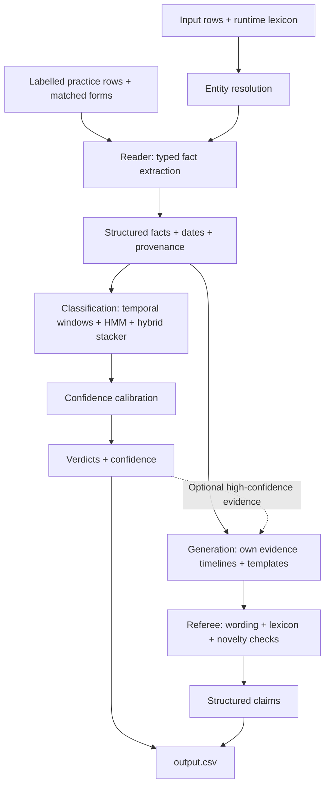

# Traceback

**Less hype. More truth.**

Traceback checks dated company claims against the available record, returns a
`true`, `false` or `unsure` verdict with confidence, and generates structured
claims from the evidence. Its interactive frontend lets you explore the
architecture, inspect extracted facts and related evidence, and download results.

Built by **Team Cercetasii** for the [QA DNA Hype Arena challenge](https://github.com/QA-DNA/hype-arena-starter).
Hooly and its universe are fictional: supplied datasets define the world, rather
than external knowledge about the real companies or products whose names appear.

## What it does

- Resolves names and aliases against the supplied lexicon.
- Extracts subjects, attributes and typed values from sentences.
- Combines temporal evidence and statistical models to classify dated claims.
- Calibrates confidence using held-out evaluation data.
- Generates up to 1,000 claims across five types: `fact`, `compare`, `change`,
  `at_event` and `relation`. Exactly 1,000 is the submission target.
- Checks generated wording, names, values and novelty with an internal referee.
- Writes classifications and generated claims into one CSV in the challenge format.

The inference engine uses the **Python standard library**. No LLM, pretrained
language model, external API or network access is required at runtime. The
frontend uses React, TypeScript, TanStack Start, Tailwind CSS and Framer Motion.

## Architecture



Classification and generation share extraction code. The Writer builds its own
timelines; it does not consume the classifier's timeline or HMM state. Practice
forms are recovered in the batch runtime only when **ID, text and date all match**.

## Run the app locally

Prerequisites: **Python 3.12**, **Node.js 22.12 or newer**, and npm. Docker is
required only for the container checks. The Python runtime needs no pip packages.

From the repository root, start the API with the official unlabelled sample:

```bash
python3 -m demo.server --sample datasets/sample.csv
```

In another terminal, start the frontend:

```bash
cd frontend
npm install --legacy-peer-deps --no-package-lock
VITE_API_URL=http://127.0.0.1:8000 npm run dev -- --host 127.0.0.1 --port 5173
```

Open [http://127.0.0.1:5173](http://127.0.0.1:5173).
The API runs at [http://127.0.0.1:8000](http://127.0.0.1:8000) and trains its Reader
at startup. Restart it after changing Python code.

### Using the frontend

1. Select **Load sample**, upload a CSV, or paste rows into the input area.
2. Choose an action and inspect the results.
3. Select a classification to explore extracted facts and related evidence.
4. Explore generated claims, their structured forms and evidence excerpts.
5. Use **Download output.csv** after a full run to save the combined result.

The frontend exposes three actions:

| Action | Intended output |
| --- | --- |
| **Classify rows** | Classifications only: `classifications.csv` |
| **Generate claims** | Generated claims only: `claims.csv` |
| **Run full pipeline + CSV** | Both classifications and claims: `output.csv` |

**Current API compatibility:** the checked-in `demo/server.py` currently implements
full runs only. Separate classification/generation modes, streaming component
traces and immutable per-run download URLs need the corresponding backend changes
restored. The frontend rejects partial-mode responses from this older API; full
runs remain available. Use the explicit `--sample datasets/sample.csv` argument:
without it, this API defaults to held-out practice rows.

When the API is unreachable, the frontend displays a saved run and a **Demo data**
badge. This is an offline preview; it does not execute inference on new rows.
The sample has no ground-truth labels, so its accuracy cannot be measured.

## Input and output

Live input uses the columns `id,text,date,label`, with empty labels for test rows:

```csv
id,text,date,label
s-01,"Emberkeep sells its team plan with 50 seats.",2026-05-23,
```

The batch runtime reads these files from `/universe/`:

- `universe.csv`: labelled practice rows plus unlabelled rows to classify.
- `lexicon.json`: entity names, aliases, attributes and events.

It writes `/output/output.csv` with the columns:

```csv
id,type,text,form,label,confidence
```

Classification entries have an empty `type`, `text` and `form`. Generated entries
contain a claim type, sentence and JSON form. Confidence is between 0.5 and 1;
`unsure` classifications have empty confidence. Output is written to a temporary
file and atomically renamed into place.

The complete interface and claim grammar are defined in
[the runtime contract](contracts/README.md), [claim forms](contracts/claim-forms.md)
and [value forms](contracts/value-forms.md).

## Run the batch engine

For a local run, prepare a directory containing `universe.csv` and `lexicon.json`:

```bash
mkdir -p output
python3 -m hooly.run --universe /absolute/path/to/universe --output ./output
```

To build the submission image:

```bash
docker build --platform linux/amd64 -t traceback .
```

Run the organisers' constrained check against that image:

```bash
sh scripts/check.sh traceback
```

Or build and check in one command:

```bash
sh scripts/check.sh
```

The checker runs offline as user `10001`, with a read-only root filesystem,
**2 CPUs, 6 GiB RAM, 256 processes/threads**, a 128 MB `/tmp`, and a 30-minute
deadline. It checks classification coverage, CSV format and the 1,000-claim count.
It does **not** establish every claim's truth or fully validate its grammar/schema.

## Verified performance

Measured on **29 October 2026**, using `linux/amd64` Docker under the challenge's
CPU, memory, user, network and filesystem restrictions:

| Workload | Container execution | Result |
| --- | --- | --- |
| Organisers' practice check: 1,897 rows, 380 labels hidden | About 24 seconds | 380 classifications + 1,000 claims; format checks passed |
| 20,000-row throughput simulation | **85.8 seconds — approximately 90 seconds** | 18,103 classifications + 1,000 claims; format checks passed |

Times exclude the image build and host-side validation. Both runs exited with
code 0 without an out-of-memory termination. The 20,000-row simulation repeated
sample text with unique IDs; it is a throughput measurement, not an accuracy test.
Its output was approximately 1 MB.

Page-grouped evaluation on practice data recorded **88.8% classification accuracy**.
That measurement does not predict the exact accuracy of the unlabelled sample or
unseen challenge data. See [experiments and evaluation notes](docs/EXPERIMENTS.md).

## Validation and limitations

```bash
# Standard-library Python tests
python3 -m unittest discover -s tests

# Held-out generated-claim audit
python3 -m evaluation.claims_eval

# Frontend checks, from frontend/
npm test
npx tsc --noEmit
npm run build
```

Verdicts are statistical estimates. Temporal continuity, freshness and stability
rules are assumptions; confidence and related evidence excerpts are not complete
proofs. Generation can use predictions marked true at confidence >= 0.95 as a
second evidence tier when needed.

The five-fold claim audit produced **4,833 confirmed, 1 contradicted and 166
unverifiable claims** out of 5,000. The target is 1,000 true claims per submission;
format validation alone does not guarantee that target. A timeout before generation
finishes can also leave the batch fallback CSV with classifications only.

## Repository guide

| Path | Purpose |
| --- | --- |
| `hooly/` | Shared extraction, classification, generation and batch runtime |
| `demo/server.py` | Local HTTP API for the frontend |
| `frontend/` | Interactive architecture, live results, claims and evaluation |
| `data/` | Labelled practice data and development lexicon |
| `datasets/sample.csv` | Official 20-row unlabelled test sample |
| `contracts/` | Submission interface, schemas and claim/value grammar |
| `scripts/check.sh` | Organisers' constrained Docker check |
| `evaluation/` | Classification benchmarks and generated-claim audits |
| `tests/` | Python tests |
| `docs/` | Pipeline explanation and experiment history |

[Original challenge repository](https://github.com/QA-DNA/hype-arena-starter)
· [Traceback repository](https://github.com/SebastianBalmus/hype-arena-starter)
