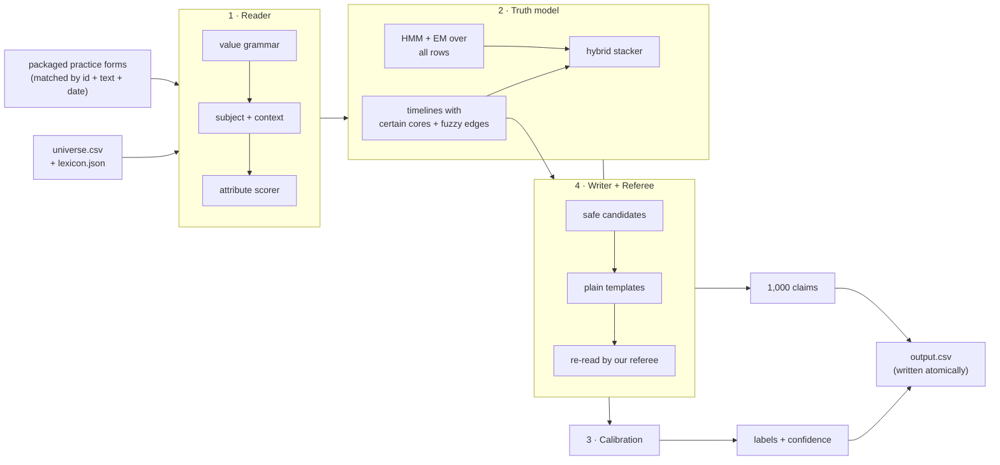

# How Hype or Truth works

A system that reads sentences about Hooly, decides whether each one is **true, false or
unsure on its date**, says how sure it is, and writes **1,000 new claims that are true**.

No LLM and no pretrained model run inside it. Every number it uses is learned from the
Hooly universe itself (the practice rows and the runtime rows), so nothing from the real
world can leak in, and every verdict can be traced back to the rows that support or
contradict it. Pure Python standard library; the whole run takes under a minute on 20,000
rows.

| Stage | Code | One line |
|---|---|---|
| Reader | `hooly/extract.py`, `hooly/reader.py` | sentence -> facts (subject, attribute, value) |
| Truth model | `hooly/temporal.py`, `hooly/hmm.py` | was that value true on that date? |
| Calibration | `hooly/calibrate.py`, `hooly/assets/calibration.json` | make "92% sure" mean right 92% of the time |
| Writer + Referee | `hooly/writer.py` | 1,000 claims that are true and readable by the organisers' referee |
| Runtime | `hooly/run.py`, `Dockerfile` | fallback table first, then labels, then claims |

---

## 1. Reader: from a sentence to facts

Every row becomes zero or more **facts**: *(subject, attribute, value)*, e.g.
*(Hooly AI Pro, price, €59 per month)*. Practice rows already carry their facts (the
`form` column); at runtime they are re-attached when id, text and date all match. Every
other row is read from its text.

1. **Values** (`extract.py`). The value grammar of `contracts/value-forms.md` as regular
   expressions: money with currency and period, percentages, durations, dates with their
   precision, versions, physical quantities, counted nouns ("4 engineers"), names, and
   comparison words ("over 5,000" is *more than* 5,000, not 5,000). Numbers inside names
   ("Hooly Android 17", "Pixel 9") are not values. It recovers 2,225 of the 2,228 values
   annotated in the practice data.
2. **Subject.** Names from the lexicon, longest first ("Hooly AI Pro" is the plan, not
   the company; "Hooly Android 16.0" is Hooly Android at version 16.0). Many sentences do
   not name their subject ("He begins with 4 engineers", "Its paid accounts..."): the other
   rows of the same page supply candidates (earlier rows first), so do distinctive name
   words ("Berlin" -> Hooly Berlin Office) and shorter names inside longer ones, and the
   company itself (the subject with the most attributes) is always a fallback. The scorer
   learns how far to trust each source. Interview speaker tags ("Gavin: ...") are not values.
3. **Attribute.** For each value, every (subject, attribute) pair whose type fits is
   scored by a small logistic regression trained on the practice facts. Its signals:
   cue words learned per attribute ("costs" -> price), local cue words right before the
   value, attribute words in the sentence, the counted noun ("3 regions" -> `regions`),
   closeness to values that fact took before, and how the subject was found. Each value
   takes its best pair, each fact at most one value. A value right after a named product ("Hooly Chrome 69.0") is a
   learned signal, and a sentence that names a product but yields nothing gets a second chance
   at a lower cut-off, with its own measured confidence. Attributes never seen in training get
   a type guessed from their name, since the runtime lexicon may hold new ones.
4. **Yes/no facts** have no value token: they are scored through their attribute's words
   ("AI sidebar", "SOC 2 certified", with crude stems: encrypts / encrypted), and a negation
   in the clause holding those words, or a bare answer after a colon ("Desktop mode: no"),
   makes the value *no*; a clause that is a plan or a hedge ("should be available in
   December") states no yes/no fact.
5. **Parse confidence.** Inside the training data, a second Reader trained without a slice
   of pages parses that slice; an isotonic map turns a parse score into "how often a parse
   like this is right". A shaky parse later counts for less.

Every statistic the Reader learns from a training row leaves that row's own page out, so
it learns exactly what it will face on unseen rows. And because the hidden data may hold
subjects and attributes the practice data never shows, training uses **cue dropout**: each
row treats about a third of all attribute names as if never seen, so the scorer also learns
to rank attributes it has no cue words for. On held-out subjects this nearly doubles the
parser's recall (0.22 -> 0.42) at higher precision.

## 2. Truth model: was the value true on that date?

Hooly's facts change over the year (prices, headcounts, versions), and pages lie in a few
recognisable ways: **stale** (last quarter's price), **premature** (next quarter's),
**inflated** ("over 5,000 attendees" when 2,600 came) or a wrong name. A lie is always
contradicted somewhere else in the universe; it cannot be spotted by how it sounds (a
text-style model scored barely above chance), so the system checks it against the record.

### 2a. Timelines with certain cores and fuzzy edges

For each fact, the values confirmed by labelled-true rows are sorted by date and grouped
into **runs** of one value. A run's first to last sighting is its **certain core**; the
gap to the next run is where the change happened (the four-date windows of temporal slot
filling). A fact in a row then gets a **state**:

| where the row's date falls | value matches? | typical meaning |
|---|---|---|
| inside a core | yes / no | true / false: 299 of 299 and 48 of 48 on held-out rows |
| in a gap | the old value / the new value / neither | stale or true, premature or true, likely a lie |
| before the first or after the last sighting | yes / no, by distance | an older or newer value, or a lie |

Three learned modifiers sharpen the states outside the cores:

- **trend**: whether the value fits the attribute's usual direction (users grow, latency
  falls; learned per attribute from the anchors). Against the trend: 80-100% false.
- **stability**: has the fact ever changed?
- **lie shape**: does the value equal one the fact held at another time? Its ratio to the
  true value? Is it rounder? *Much bigger and rounder* was false 26 times out of 28.

How likely each state is to be true, false or unsure is **counted** on the training rows
(each with its own page left out), with rare states backing off to coarser ones. No
hand-tuned thresholds.

### 2b. Probabilistic timelines (HMM + EM)

A second, more principled view: per fact, a **hidden Markov model** over which value is
true at each observed date. The value stays put with probability exp(-gap / tau), else
changes. A labelled-true row pins the state, a single-fact labelled-false row rules its
value out, and every other row tells the truth with probability alpha. **EM** learns
alpha and tau from all rows at once (on practice: tau of about 230 days between changes),
and forward-backward gives each row's probability that its value was the true one. It
uses the unlabelled rows as evidence, so it gets stronger with the 18,000 unlabelled rows
of the real run.

### 2c. Hybrid and the row verdict

A small logistic regression weighs the two views (2a and 2b). One exception, the **regime
gate**: when no labelled anchor backs any of a row's facts (a subject the practice data never
shows), the timeline view has nothing to say, so the HMM alone decides if it confidently says
*false* with cross-row evidence on at least 4 dates. The HMM scores it learns from
are out-of-fold: each training row's label is hidden from the HMM that scores it. A row
is true only if all its facts are, so a row's probability of being true is the product
over its facts; *unsure* is chosen only when it is the most likely label (rare: 2% of
rows are unsure).

## 3. Calibration

Cross-fitted **isotonic regression**, one map per label: "when we said *false* with
probability p, how often were we right?". A *false* call whose calibrated chance drops
below 0.5 flips to *true*. On unseen pages, calibrated confidence matches reality closely
(said 0.82 -> right 0.82, said 0.92 -> right 0.92), with an expected calibration error of
about 0.02. The runtime map ships in `hooly/assets/calibration.json`.

**Hype-aware confidence.** Boastful or first-person sentences ("never", "the best",
"more than any", "I") are lies about twice as often, and our verdicts on them were right
78% of the time while claiming 88%. Their confidence is shrunk towards 0.5 (factor 0.73,
learned on held-out pages), so it matches how often we are right there. Labels do not change.

### Example: one row end to end

> *"over 5,000 attendees in the room today"* (a page from 9 June 2026)

1. Reader: value *more than 5,000 attendees*; no subject named, the page's earlier rows
   give Hooly Cloud Next 2026; attribute `attendees` (counted noun).
2. Timeline: the record says 2,600 attendees; the claimed bound fails.
3. Lie shape: about 1.9x the true value and rounder.
4. Verdict: **false**, with high confidence and its evidence: the rows that say 2,600.

## 4. Writer + Referee: 1,000 claims, every one true

Truth comes only from **labelled-true facts**. Candidates, safest first:

| type | example | why it is safe |
|---|---|---|
| change | *The price of Hooly Pixel Fold went from €1,799 to €1,599.* | both values confirmed true, in time order |
| compare (dates) | *The launched of Hooly Chrome came before the joined of Bertram Gilfoil.* | past dates cannot change any more |
| relation | *For the CTO of Hooly, the joined is 1 July 2026.* | link and target fact both confirmed, target never changed |
| at_event | *At the time of Hooly Maps Day, the cold start time of Hooly Chrome was 1.9 seconds.* | the value's certain core covers the event's final date |
| compare (amounts) | *Hooly Translate has more offline languages than Hooly Meet has caption languages.* | recent values only, at least 1.5x apart |
| fact | *The version of Hooly Docs is version 2.0.* | an immutable date or a value seen in the last 30 days |

Every claim is rendered with **plain templates** in the exact value forms of
`value-forms.md` and **re-read by our own Referee** before it is kept: the subject is
named, the value is read back exactly once, no competing value, date, time word or
negation, no number at all in a comparison, one new sentence, and the subject and
attribute exist in the runtime lexicon. At most 6 claims per fact (relaxed only if short)
keep the set varied. If labelled facts ever run short, a second tier uses rows the system
itself labelled true with at least 95% confidence, at lower claim confidence.

**Do the claims hold up?** Generated with a fold of pages hidden and checked against all the
practice data: 4,678 confirmed, 1 contradicted (a rescheduled event), 101 unverifiable.
Generated from pages before 1 September only: 622 claims, none contradicted; the Writer
declines "as of 29 October" claims when its evidence is old. The remaining risk is
wording our Referee accepts but the organisers' referee reads differently, which is why
the templates stay plain.

## 5. Runtime

`python -m hooly.run` (the container's command):

1. read `/universe/universe.csv` and the runtime lexicon;
2. write a **fallback table at once** (every row *true* at the base rate), so a crash or a
   timeout still hands in something valid;
3. Reader -> hybrid -> calibration -> labels, written; then the 1,000 claims, written;
4. every write goes to a temporary file renamed into place; on SIGTERM the last complete
   table stays;
5. a **self-check** in the log: lexicon facts the practice data never shows, the share of
   rows in each regime (nothing parsed / parsed without a labelled anchor / anchored), and
   the expected accuracy of this very run (mean calibrated confidence; on a practice-shaped
   input it said 0.881, the truth was 0.876).

Image: `python:3.12-slim`, no downloads, no models, `USER 10001`, read-only root friendly.
A simulated 19,000-row universe runs in 47 seconds (limit: 30 minutes), output 0.7 MB
(limit: 16 MiB).

## 6. How good is it?

Measured with whole pages held out (the system sees only their text) and on the team's
shared benchmark (`arena-eval-v1`). Details and every experiment, including the ones that
failed, are in [`EXPERIMENTS.md`](EXPERIMENTS.md).

| test | accuracy | macro F1 |
|---|---|---|
| always say *true* | 0.818-0.853 | 0.30 |
| **ours, pages held out** | **0.888** (0.872-0.905) | 0.52 |
| ours, team benchmark: stratified / temporal / checker | 0.866 / 0.830 / 0.874 | 0.50 / 0.41 / 0.50 |

Stress tests: with only 10% of labels the HMM still reaches 0.869 (gold facts); on subjects
never seen in training the system stays near always-true with our parser (0.818) and reaches
0.866 with perfect parsing, so parsing new material is the main remaining limit.

Expected on the hidden data: **about 0.88, plausibly 0.85-0.90**. More anchors and more
unlabelled rows at runtime push it up; subjects, attributes and phrasings the practice data
never shows push it down. Claims: expected precision above 0.95.

Built with the help of an AI coding assistant during development (allowed by the rules);
the submitted system contains no LLM.
