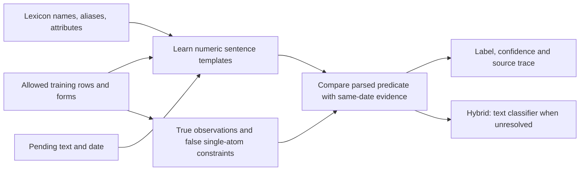

# First knowledge-base experiment

The first implementation turns permitted practice annotations into dated evidence,
then uses training-derived templates to parse new numeric assertions. It supports
money, counts, durations and percentages. It is a classification experiment;
generation, the frontend and the submission container are still unimplemented.



`parser.py` learns templates from all permitted training labels, because forms
describe assertions even when those assertions are false. It replaces an explicit
entity name and a numeric value with markers and requires the rest of the wording
to match. It handles known aliases, preserves value dimensions and operators,
and rejects ambiguous, compound, negated and temporal wording. This deliberately
small parser has very low coverage on new phrasing.

`store.py` indexes supported numeric observations from true rows, with source
IDs, immutable text, dates, forms and fingerprints. False single-atom rows exclude
only their stated predicate. False compounds remain constraints without being
negated atom by atom. Unsure rows add no world facts. Values are compared using
Decimal intervals; currencies, billing periods and incompatible units stay
separate. Historical, planned and otherwise out-of-scope observations are excluded
by conservative cue filters, which are heuristics rather than a complete temporal
parser.

Queries use the exact observation date. No fact is silently carried to another
date. Contradictory evidence remains unresolved. For complete required conjunctions,
one contradiction implies false and complete support implies true; the initial
parser deliberately emits only single-assertion parses.

The lexicon supplies vocabulary, not factual values. Training annotations are
accepted only when their ID, text, date and label match a labelled runtime row.
Pending-row forms are rejected. The method never opens the full practice dataset.
The evaluator is responsible for supplying only the split-permitted forms.

## Run a comparable experiment

From the repository root:

```sh
.venv/bin/python evaluation/run_kb_experiment.py --run-id NEW-UNIQUE-ID
```

This runs both `kb_same_date` and `kb_hybrid` on all three frozen tracks under
`fixed_050`. The latter falls back to the predeclared `word_char_lr_balanced`
model when evidence cannot produce an emitted T/F decision. Its fallback is a
text classification prediction, with uncalibrated model confidence.

First, evidence and parser assets are fitted using each track's inner fit rows.
The evaluator uses inner validation labels to estimate correctness separately for
raw true and false decisions: `(correct + 1) / (count + 2)`. Then it refits the
assets on the whole outer training pool before test inference. The threshold is
fixed at 0.50. A zero-count bucket is explicitly a prior-only score of 0.50; sparse
validation decisions and refitting do not establish probability reliability.

The method CLI can also consume explicitly prepared split files:

```sh
.venv/bin/python experiments/kb_predict.py \
  --input /path/to/sanitized-runtime.csv \
  --training-forms /path/to/permitted-training-forms.csv \
  --lexicon data/lexicon.json \
  --mode kb_only \
  --output /tmp/kb-predictions.csv \
  --artifacts /tmp/kb-artifacts
```

Runtime input columns are exactly `id,text,date,label`; pending labels are blank.
The forms file has `id,text,date,label,form` and contains exactly the labelled
runtime rows. Without `--calibration`, this CLI uses an explicitly uncalibrated
0.50 score for raw evidence decisions; the evaluator uses that mode only to
collect validation decisions.

## Inspect an experiment

Each method has its own `results/evaluations/<method>/<run-id>/` directory:

| Artifact | Contents |
| --- | --- |
| `run.json` | Source and asset hashes, data boundaries, IDs, calibration and runtime metadata |
| `fixed_050/<track>/kb_records.jsonl` | Permitted source observations and constraints, with provenance |
| `fixed_050/<track>/traces.jsonl` | Parse, evidence, rule, unresolved reason and route for every prediction |
| `fixed_050/<track>/diagnostics.json` | Parser coverage, evidence counts, abstention reasons and native timings |
| `fixed_050/<track>/predictions.csv` | Method predictions, with no evaluator gold |
| `fixed_050/<track>/scored_predictions.csv` | Evaluator-only predictions joined with gold |
| `fixed_050/<track>/calibration.json` | Validation correctness counts and confidence estimates |

Validation method artifacts are retained under the `kb_same_date` run's
`validation/<track>/`. No held-out gold is placed in the method input files.
Separation is logical: subprocesses are not protected by an OS filesystem sandbox.
Traces are execution records, not independently accepted proofs.

Measured results and the next bottleneck are in
[the experiment report](../research/knowledge-base-experiment.md).
