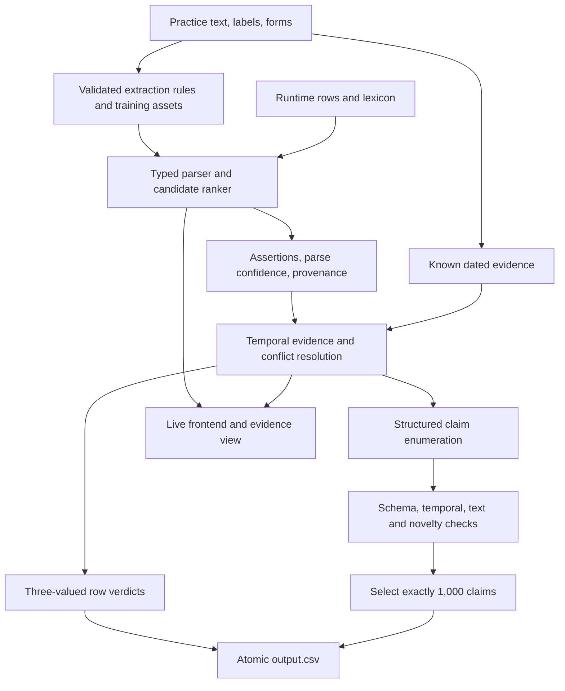

# Hype Arena: approaches, evidence, and a proposed build order

Research date: 28 October 2026. Repository inspected at `7c32449`.

**Recommendation:** build a typed temporal knowledge base with a deterministic reasoner and claim renderer. Start with rules and retrieval to extract facts, then add a small supervised candidate ranker where rules miss paraphrases. Use LLMs during development to help prepare rules, synthetic examples, and auditable timelines; ship no LLM in the runtime. Add probabilistic joint inference only if error analysis shows that evidence conflicts, rather than extraction, are the limiting factor.

The important design choice is to separate **what a sentence asserts**, **whether its assertion is true at its date**, and **whether a generated sentence satisfies the referee's grammar**. These are three different problems.

| Approach | Best use | Main cost | Recommendation |
| --- | --- | --- | --- |
| A: rules and curated temporal evidence | Reliable initial system | Language coverage | Build first |
| B: learned extraction plus symbolic reasoning | Broader language coverage with inspectable facts | Training and validating candidate associations | Recommended destination |
| C: joint probabilistic reconstruction | Conflicts and missing change boundaries | Inference complexity and assumptions about noise | Add only for measured bottlenecks |
| Direct text truth classifier | Cheap experimental control | Weak factual grounding for generation | Measure; do not make it the foundation |

## What the repository actually requires

The authoritative local sources are [the task](../README.md), [the runtime and output contract](../contracts/README.md), [claim forms](../contracts/claim-forms.md), and [value forms](../contracts/value-forms.md).

The runner receives roughly 20,000 sentences, including the labelled practice rows. Approximately 18,000 rows will need labels. Its input supplies `id,text,date,label`, **without forms**. Bundling the public practice data, including its forms, is explicitly allowed. The runtime lexicon is supplied separately and should be read rather than replaced with a hardcoded copy.

The output combines predictions and exactly 1,000 generated claims in one CSV. Predictions can be `true`, `false`, or `unsure`; `unsure` has an empty confidence. Generated claims must be true, with confidence between 0.5 and 1. Their text and structured form must agree under a deterministic grammar.

| Claim type | Temporal meaning | Main evidence needed |
| --- | --- | --- |
| `fact` | Value on 29 October 2026 | Supported current value |
| `compare` | Comparison on 29 October 2026 | Two supported, compatible current values |
| `change` | One value held, then another later | Two dated observations in the correct order |
| `at_event` | Value on the event's date | Resolved event date and value at that date |
| `relation` | Target's value while a link named that target | Overlap between the link's validity and the target fact's validity |

Historical claims do not require the earlier value to remain current. That makes them useful when current-state evidence is weak. A relation requires temporal overlap; independently knowing a person's employer and that they once held a role is insufficient.

The image must fit within 3 GiB unpacked and run offline on 2 CPUs and 6 GiB RAM for at most 30 minutes. It must end its Dockerfile with `USER 10001`, work with a read-only root and no home directory, respect the small writable mounts, and atomically publish `/output/output.csv`. The frontend must show an architecture diagram and execute the same system live on supplied rows.

The README publishes sample release at 09:00 and submission freeze at 11:00 on 29 October. It does not specify a timezone. The submission is a PR from a public fork; pushes or closing the PR after the freeze disqualify the team. The current checkout points at the upstream starter, so creating the team's fork is a future implementation step.

## What the data tells us

These measurements come from [the reproducible probe](probe.py) and its [JSON output](findings.json), not from external company information.

| Measurement | Result | Design consequence |
| --- | ---: | --- |
| Practice rows | 1,897 | Small supervised dataset |
| Labels | 1,581 true; 277 false; 39 unsure | Accuracy alone hides important failures |
| Subjects / subject–attribute slots | 62 / 514 | A compact structured world is practical |
| Structured assertions across rows | 2,402 | Train extraction from all forms, regardless of truth label |
| Rows containing multiple assertions | 430 | Reason at assertion level, then combine |
| False rows containing multiple assertions | 75 | A false row does not make every component false |
| Slots with at least one true row | 502 | Most of the schema has some positive evidence |
| Slots with an exact true value | 501 | Bounds alone cannot supply an exact generated value |
| Slots with multiple canonical exact values | 245 | Temporal modelling is central; some differences also concern date precision |
| Rows with no whole-word lexicon name or alias | 561, or 29.6% | Literal entity matching will leave many rows unresolved |
| Assertions explicitly naming their own subject or alias | 1,647 / 2,402 | A name elsewhere in a sentence need not identify the asserted subject |
| Distinct text strings appearing with different labels | 4 | Cache truth by dated assertion, not text alone |

The probe normalizes common units and known entity aliases when counting canonical values. It is a research utility, not a complete implementation of the referee's value grammar.

**A useful multi-assertion example:** `p-1579`, dated 5 March 2026, says that AI Pro costs €49/month and has a seven-day trial. The row is false. Other practice evidence supports the price at that time and a fourteen-day trial. Training both assertions as false would damage correct knowledge.

**A useful temporal example:** the exact sentence “Hooly Search has 540,000,000 users each month.” is true in `p-108` on 25 February and false in `p-1217` on 16 June. Similar wording is evidence about the asserted fact, not its truth.

**A useful uncertainty example:** the Pixel Fold hinge's 200,000-fold rating is true in June rows and unsure in `p-608` on 18 August. A once-true value cannot automatically be carried forward forever. This is consistent with date-specific missing knowledge; it is not enough evidence to declare the annotation erroneous.

There are twelve slots without any true practice row. They include annual recurring revenue, Calendar active users, several Pixel specifications, and the date of I/O 2027. Negative or unsure evidence does not supply their missing true values.

Only 214 of the 501 exact-value slots have their latest positive observation in October; another 82 have it in September. Publication recency matters, but a recent observation still does not certify the as-of date. Also, a planned event date can change: the practice rows give different dated schedules for Cloud Next, Maps Day, and Made by Hooly.

Some ambiguity is an information limit. If an unseen assertion has no resolving evidence, two different world states can fit the known anchors. A more elaborate classifier cannot turn that into a proof. The engine needs explicit assumptions about persistence and noise, plus the ability to leave a question unresolved.

## Small experiments: what fails before building a larger system

I ran two deterministic splits. In both, test labels and test forms are excluded from the training evidence and retrieval index.

1. **Every fifth row hidden:** 1,517 training rows and 380 test rows, matching the checker’s masking pattern.
2. **Forward stress test:** train on 1,398 rows before 1 September; test on the remaining 499 rows. This deliberately tests future change and is stricter than the final run, which includes labelled anchors throughout the year.

The text baseline uses word unigrams and bigrams, training-only TF–IDF, and cosine nearest-neighbour label copying. Its dated version divides similarity by `1 + abs(date_gap_days)/90`. This is an untuned control, not a claim about the best possible classical classifier.

| End-to-end baseline | Every-fifth accuracy | Every-fifth macro F1 | False recall | Forward accuracy |
| --- | ---: | ---: | ---: | ---: |
| Always predict true | 85.3% | 0.307 | 0% | 81.8% |
| TF–IDF nearest-neighbour label | 80.0% | 0.374 | 20.4% | 71.5% |
| Same, with date penalty | 80.3% | 0.385 | 24.5% | 73.3% |

This exposes an evaluation trap: predicting true everywhere can look impressive while detecting no false statements. Conversely, retrieval improves false recall here but makes enough other mistakes to reduce accuracy. Its best role is likely finding **candidate meanings and templates**, followed by reasoning about values and dates.

I also ran **privileged gold-form diagnostics**. These read the test row's gold form to bypass parsing completely, and compare it with exact values in true training rows. They are not deployable models, optimized oracle bounds, or predictions of final scores.

| Gold-form diagnostic, every-fifth split | Decided coverage | Precision on true/false decisions |
| --- | ---: | ---: |
| Use only positive observations on exactly the same date | 6.1% | 100%, on only 23 decisions |
| Carry the latest earlier positive value forward | 67.1% | 72.5% |
| Use the closest dated positive value, before or after | 88.4% | 77.4% |

The diagnostics intentionally omit sophisticated change detection, negative constraints, and inference from unlabelled rows. Their lesson is narrower: **perfect extraction does not rescue naïve temporal lookup**. On the forward stress test, carrying the last value forward has only 45.3% decided precision.

## Possible approach A: rules, curated timelines, and a deterministic engine

**Best when:** the priority is a reliable hackathon submission with transparent evidence.

Build a lexicon-driven entity resolver; parsers for typed values; rules mapping wording to attributes; a dated evidence store; three-valued reasoning; and a template generator. Use the practice forms to mine attribute phrases and learn short aliases that are useful for input parsing. Generated names still come from the official lexicon.

During development, use LLM assistance to turn labelled observations into proposed timeline assets and extraction rules. Require each factual asset to cite practice row IDs, its observation date, and the inference made. Review proposed boundaries and test the compiled assets. At runtime they are ordinary data and code.

This takes advantage of an explicit permission in the README: LLMs may help build the system and make what it learns from. It does not justify inventing values, reading fictional Hooly facts from the web, or calling an LLM during the run.

**Strengths:** small footprint, fast CPU execution, clear provenance, easy live explanations, and a direct route to deterministic generation.

**Weaknesses:** hand-built language coverage is expensive; pronouns and short headlines are hard; an incorrectly curated change boundary affects many predictions. The practice data alone may leave genuine gaps.

**Upgrade trigger:** rules parse the common cases correctly but leave a substantial set of recognizable paraphrases unresolved.

## Possible approach B: learned extraction with symbolic temporal reasoning

**Best when:** we want stronger language coverage without weakening the reasoning or runtime constraints. This is my recommended destination.

Keep the engine from A. Replace brittle extraction choices with candidate ranking:

1. Find entity spans and plausible implicit subjects using the lexicon and learned wording.
2. Parse money, quantities, dates, versions, names, booleans, and bounds deterministically.
3. Propose subject–attribute–value associations allowed by that subject's schema.
4. Rank these candidates using a small logistic model or another classical classifier.
5. Preserve several plausible parses when they disagree materially; abstain if their resulting verdicts differ.

Useful features include local word and character n-grams, attribute cue phrases, subject/value distance, clause boundaries, value dimension, negation scope, and agreement with the observed frame templates. Character TF–IDF can help with spelling and formatting variation; the official [vectorizer documentation](https://scikit-learn.org/stable/modules/generated/sklearn.feature_extraction.text.TfidfVectorizer.html) describes the available analyzers.

Train extraction from **all** practice forms: a false claim can still have a perfectly valid parse. Train factual evidence separately using the truth labels. With only 2,402 assertions across 514 slots, I would avoid starting with a flat 514-way classifier. Candidate ranking and entity-conditioned attribute decisions share more statistical strength.

Use synthetic paraphrases to improve coverage of aliases, units, clause order, and attribute wording. Derive their forms mechanically, validate them, and split original examples before producing their synthetic descendants. Changing the asserted number preserves the extraction task but does not automatically produce a correctly labelled truth example.

**Strengths:** handles paraphrases, retains an inspectable reasoning layer, and should fit the CPU and memory envelope comfortably if implemented with sparse features. This resource expectation needs benchmarking.

**Weaknesses:** association errors can attach a valid value to the wrong attribute. Gold forms do not include token spans, so creating span supervision requires care. An opaque truth classifier must not silently become the factual source for generated claims.

**Upgrade trigger:** extraction is strong but conflicting statements and poorly located changes dominate remaining errors.

## Possible approach C: joint probabilistic world reconstruction

**Best when:** there is enough implementation time to address the deeper problem of conflicting, incomplete evidence across the whole input.

Treat each fact's value at each relevant date as a latent state. Give known labelled evidence high weight, extracted unlabelled observations lower and calibrated weights, and changes a soft cost. Include an explicit unknown state rather than forcing every slot to have a value.

Useful constraints include unit compatibility, mutually exclusive exact values for a genuinely single-valued attribute, clause-level conjunction, and event/link consistency. A labelled false compound row imposes “at least one component is false,” not “every component is false.” Attributes that represent sets or have partial-date values need separate treatment.

Start with per-fact dynamic programming over dated candidate states. Add cross-fact constraints in a bounded iterative pass only when needed. Avoid a large unconstrained graph solver as the first implementation. Copied wording and correlated extraction rules must not count as independent corroboration.

This resembles the established knowledge-base construction pattern of extraction, weighted evidence, and statistical inference described in the [DeepDive paper](https://cs.stanford.edu/~chrismre/papers/deepdive_highlight.pdf). That is architectural inspiration, not a recommendation to deploy the old DeepDive stack.

Multiple rule outputs can also be treated as weak supervision. [Snorkel's paper](https://pmc.ncbi.nlm.nih.gov/articles/PMC5951191/) explains combining noisy labelling functions and accounting for their dependencies. Here, the important distinction is between a rule **abstaining** and a rule predicting the dataset's `unsure` class. They should have different internal representations.

**Strengths:** uses the 18,000 unlabelled rows as additional evidence and models dates, conflicts, and uncertainty together.

**Weaknesses:** the most complex option; confidence can be badly inflated by correlated evidence; a smoothness prior can suppress real changes. The assumptions about noise and persistence are not guaranteed by the contract.

**Decision:** prototype it only after A/B provide an observable baseline and a valid submission path.

## A fourth path worth measuring, but not making the foundation

A direct text-and-date truth classifier—TF–IDF plus logistic regression, for example—is easy to train and useful as a control or weak signal. It does not by itself produce the structured, dated premises needed to generate true new claims. Our nearest-neighbour results also show how easily lexical resemblance misleads truth decisions.

I would not spend the initial hours on a small generative model or pretrained language-model encoder. A generative LLM conflicts with the rule. Whether an encoder is acceptable under “the system itself may not be an LLM” needs an organizer ruling; classical sparse models avoid that dependency.

## The architecture I would implement



For a small corpus, ordinary Python structures or SQLite should suffice; a graph database and vector database are not prerequisites. Keep batch execution and the frontend as adapters around the same core functions.

Processing 20,000 rows in 30 minutes requires an average above 11 rows per second before allowing time for generation and validation. Sparse retrieval and indexed, per-fact timelines are reasonable starting points. Benchmark the complete offline run; a fast parser does not establish the cost of joint inference or claim validation.

An assertion record should preserve: input row ID, publication date, subject, attribute, original typed value, normalized value, comparison operator, parse alternatives, and evidence status. Store observation dates separately from inferred validity intervals. “Observed on 1 April” and “changed on 1 April” are different claims unless the wording or other evidence establishes the boundary.

The basic verdict rule is:

- `false` if at least one asserted component is contradicted at the relevant date;
- `true` if every asserted component is supported and extraction is sufficiently complete;
- `unsure` otherwise.

Internally distinguish missing world knowledge, conflicting evidence, uncertain subject resolution, and incomplete extraction. They may all require an `unsure` output but call for different improvements. Do not mark a row true merely because the one component successfully extracted is true.

Use labelled true rows as positive anchors. A single-assertion false row supplies a negative constraint at its date, not a replacement true value. An unsure row is evidence of unresolved truth at its date, not an eternal ban on that attribute. Parsed unlabelled statements are observations to assess, not new ground truth by default.

Do not assume neighbouring CSV rows belong to one page. The input contract provides no document IDs or ordering guarantee. Adjacency can be evaluated as a soft feature, but predictions should be checked under row shuffling.

## Generating exactly 1,000 claims

Generation should enumerate structured candidates, check their premises, then render them using a small set of canonical templates. This is a compiler task: open-ended prose generation adds unnecessary failure modes.

The practice corpus offers the following **unverified candidate capacity**:

| Candidate source | Count | Why it is not yet a certified pool |
| --- | ---: | --- |
| Slots with an exact positive value | 501 | Latest observed value may be stale |
| Unordered pairs with compatible dimensions and date precision | 4,249 | Need valid as-of values, semantic wording, and grammar checks |
| Same-attribute subset of those pairs | 409 | More natural comparisons, still subject to the same checks |
| Ordered observed value differences | 436 | Need correct temporal interpretation and renderable, genuinely different values |

For observed changes, counting normalizes aliases and common units, excludes identical values, and excludes changes between dates of different precision. Comparison candidates can have equal values, yielding `eq` claims. These counts still do not establish hidden-state validity, and the pools overlap across claim types.

Comparisons are the obvious source of scale. Prefer useful pairings: product prices, storage, trial durations, device specifications, event attendance, or compatible release dates. The contract does not publish a quota per claim type. Enumerate several thousand candidates, retain the best supported 1,000, and enforce semantic uniqueness internally rather than filling the quota with cosmetic rewrites or reversed duplicates.

Historical `change` claims can use directly supported earlier and later values without inventing a precise transition date. `at_event` can be strong when both the final event date and the value on that date are supported. Some listed events lack a public `date` attribute, so the event list alone is not enough to generate one of these claims. `relation` should come later because its temporal join is more demanding.

For every candidate, retain its supporting row IDs and any inferred intervals in an internal proof record. The CSV schema does not accept arbitrary citation fields inside `form`; keep proofs in a sidecar or the frontend.

The validator needs to check all of the following:

1. The structured entry matches `entry.schema.json`, resolving its local value-schema reference. Construct `tag: true` for this schema check, then serialize it to the CSV's `label` column.
2. Subjects, attributes, targets, and event names resolve through the runtime lexicon.
3. The premises support the claim under its own temporal semantics.
4. The text states exactly the structured claim using the allowed phrases and value spellings.
5. The text is new relative to the **entire runtime input**, is one sentence and at most 300 characters, and its ID is unique across the output.
6. The final table has exactly 1,000 claims, all required prediction rows, and valid confidences within the 16 MiB limit.

In particular: retain money periods; never turn “over 100 customers” into exactly 100; normalize 14 days and two weeks; preserve version precision; and handle partial dates explicitly. A year and a specific day within it are not automatically contradictory observations or a historical change.

Input extraction and output validation should share value types, but **not blindly share one restrictive grammar**. The practice input contains headlines, implicit subjects, and forms that the generated-claim grammar would reject. Generated text can use deliberately simple language.

The supplied checker does not verify claim truth, text/form agreement, full schemas, or lexicon membership. Its practice novelty check is also not a substitute for checking every runtime row. Passing `check.sh` is necessary infrastructure evidence, not a semantic score.

## Evaluation and confidence

Build separate measurements for extraction, temporal reasoning, and generation. Otherwise a wrong verdict gives little guidance about what to fix.

For extraction, measure subject–attribute accuracy, typed-value accuracy, assertion recall on compound rows, and complete-frame accuracy. For verdicts, track per-class precision/recall, macro F1, decided coverage, and error rate at each confidence threshold. For generation, count schema-valid, text-valid, temporally supported, distinct candidates by type before selection.

Use ordinary held-out rows as an initial check, plus held-out normalized templates and date windows. Group synthetic descendants with their source example. Rebuild evidence stores and learned extraction assets from training rows for each evaluation; deleting labels while retaining their forms in a compiled answer table is leakage. The official checker explicitly warns that bundling the full practice data makes its hidden-row score an upper bound.

The general rationale for grouped and temporal evaluation is covered in [scikit-learn's cross-validation guide](https://scikit-learn.org/stable/modules/cross_validation.html). Template groups are an approximation here: the supplied data has no page/document identifier. The forward split is a stress test, not a replica of final-run sampling.

Treat cosine similarity as a retrieval score, not a probability. Fit confidence on held-out predictions. With this dataset size, start with a simple sigmoid calibration and inspect reliability rather than fitting a highly flexible calibrator; [scikit-learn's calibration guide](https://scikit-learn.org/stable/modules/calibration.html) describes why isotonic calibration can overfit small samples.

Generated-claim confidence must include extraction, temporal validity, and all joined premises. Do not assign 0.99 merely because the renderer is deterministic. Repeated claims sharing a premise also share its failure risk.

The supplied contract does not specify a numerical scoring formula or relative weights for confidence, abstention, classification, and generation. Therefore an optimal abstention threshold or type mixture cannot be derived from it. Preserve the ability to tune those choices without changing the parser.

## A practical implementation order

**First, establish a submission path.** Create the fork when implementation begins; define the core input/output types; make the offline runner and frontend invoke the same core; implement schema-aware serialization and deadline-safe atomic writes. Confirm an amd64 Docker build runs under the supplied restrictions early.

**Next, build A as a measurable floor.** Load practice forms as dated evidence, with ID/text/date consistency checks when joining the runtime rows. Implement aliases, typed values, compound-row semantics, a conservative timeline resolver, and simple renderers. Measure whether a sufficiently supported 1,000-claim pool exists before spending much time on the UI.

**Then add the high-value part of B.** Review the unresolved cases and train a candidate ranker for the common language patterns. Use LLM-assisted development to produce bounded parser rules and validated paraphrases. Focus on the errors measured in held-out evaluation.

**Add C selectively.** If the main remaining errors concern conflicting evidence or change boundaries, implement a small weighted temporal model. Keep a deadline-bounded fallback to the earlier engine and avoid feeding its own predictions back as independent facts.

**Finish the demonstration and freeze.** The frontend should accept CSV, show the architecture beside predictions, and expose a row's parsed assertions, evidence dates, confidence, and reason for uncertainty. At sample release on 29 October, run the 20 rows live, record the required video, complete checks, and stop pushes before the published freeze.

I would reserve explicit integration time rather than treating the frontend, Docker restrictions, and claim validator as final-hour tasks. This research did not build or benchmark an Arena image, implement a frontend, or create a fork/PR.

## Questions that would materially change the design

- What is the scoring formula, including confidence penalties and the relative value of abstention versus a wrong answer?
- What timezone governs the sample release and freeze?
- Are frozen pretrained encoder models permitted by the non-LLM rule? The proposed classical implementation does not need this answer.
- How are events without an exposed date fact resolved for `at_event`, and how are partially known dates compared?

None of these prevent starting the recommended classical, typed architecture. They do prevent claiming that one confidence threshold or candidate mix is mathematically optimal.

## Reproduce the local research

From the repository root, with Python 3 and no third-party dependencies:

```sh
python3 research/probe.py --output research/findings.json
```

The JSON includes full confusion counts for the simple baselines and privileged diagnostics. These experiments establish failure modes and a starting point for architecture choices; they do not establish the performance of the recommended system, which remains to be implemented.

External research was used only for methods, not for facts about Hooly. The linked demo website could not be retrieved through the web research tool, so its contents were not used to fill gaps in the local contract.
