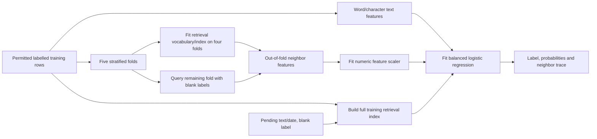

# Retrieval features for label classification

This experiment learns how a query relates to labelled examples. It appends
retrieval features to the existing balanced word/character TF-IDF logistic
regression. It does not add retrieved statements to the factual knowledge base.

The two fixed candidates are `retrieval_raw`, using original text for retrieval,
and `retrieval_raw_masked`, adding a second view with numeric surfaces replaced by
`NUM`. Retrieval uses word unigrams/bigrams, sublinear TF-IDF, at most 20,000
features and cosine similarity. Both candidates retain the original text
classifier's word/character representation, balanced classes and C=1.0.

## What the model compares

`features.py` returns 38 numeric features per view. These describe similarity to
true/false/unsure reference classes, the class mix of the top five examples,
nearest-class date gaps, explicit entity overlap, numeric agreement, currency and
billing-period matches. The raw+masked variant has 76 such features.

Entity aliases map to their canonical lexicon subject, with longer names taking
precedence over contained names. Numeric equality and overlap compare untyped
sets of numbers, not complete subject-attribute-value assertions. A match may
concern a version, an incidental number or a date; units and negation are not
fully interpreted. Currencies and periods are separate heuristic indicators.
These are inputs to a statistical classifier, not proofs of support or conflict.

References need not have the same date as the query. Signed and absolute date
gaps allow the classifier to learn patterns in dated examples. This creates no
factual persistence rule and supplies no evidence for generated claims.

## How training avoids self-matches



Every training row receives retrieval features from its other four folds. The
retrieval vocabulary, IDF weights and index are fitted only on those reference
rows. Query labels and forms are stripped before feature extraction. Text
features are fitted on the full permitted training pool, as in ordinary
supervised learning. The numeric feature scaler is fitted on the out-of-fold
feature matrix. Inference uses a full training index, producing a documented
difference in reference-pool size and IDF from the training folds.

The fixed 0.50 policy preserves native unsure predictions and emits unsure for a
T/F winner below 0.50. Reported probabilities are uncalibrated.

## Run the experiment

```sh
.venv/bin/python evaluation/run_retrieval_experiments.py --run-id NEW-UNIQUE-ID
```

The evaluator first compares both candidates with a fresh unchanged
`word_char_lr_balanced` control on each track's inner validation rows. It freezes
the highest validation macro F1 candidate, with baseline-first tie-breaking,
before any test fit. Each candidate is then refitted on the full outer training
pool and scored on all test IDs. `retrieval_selected` reuses the selected
candidate's final predictions, with references to its detailed artifacts.

The method subprocess receives `id,text,date,label` only. Labelled rows train the
method and blank-label rows are pending. The evaluator alone reads practice gold
and supplies the frozen split files. Neither method accesses practice forms.
Separation is logical, without an OS filesystem sandbox. Related examples can
cross the existing development splits.

For an explicitly prepared runtime file:

```sh
.venv/bin/python experiments/retrieval_predict.py \
  --input /path/to/runtime.csv \
  --lexicon data/lexicon.json \
  --variant raw_masked \
  --output /tmp/retrieval-predictions.csv \
  --artifacts /tmp/retrieval-artifacts
```

Each target class needs at least five labelled rows for the fixed five-fold
procedure. The CLI fits on labelled rows in its input; supply only the training
rows permitted for the evaluation in question.

## Artifacts

Under `results/evaluations/<method>/<run-id>/`, `validation/<track>/` contains
inner validation results and `fixed_050/<track>/` contains test results.

| File | Purpose |
| --- | --- |
| `predictions.csv` | Labels, confidence, reason and full model probabilities |
| `scored_predictions.csv` | Evaluator-only join with held-out gold |
| `traces.jsonl` | Global and per-class reference examples used for pending rows |
| `oof_traces.jsonl` | Training query/fold and its reference neighbors |
| `oof_folds.json` | Complete query/reference ID sets per training fold |
| `feature_names.json` | Combined text and retrieval feature names |
| `diagnostics.json` | Feature counts, class counts, folds and native timings |
| `metrics.json` | Classification, output validity and reference-boundary audits |
| `run.json` | Input/source/artifact hashes, row IDs, commands and limitations |

The evaluator audits every exposed global and per-class neighbor against the
allowed fold or outer training rows, including its label and date. It also
requires complete training-query and pending-query trace coverage. Neighbor
traces are statistical explanations; accepted factual proofs, generation,
frontend and constrained-container benchmarking are not implemented.

Results and interpretation are in
[the experiment report](../research/retrieval-experiment.md).
